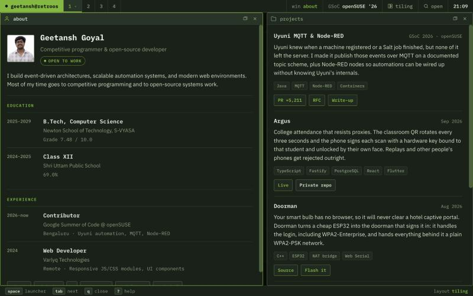

## Geetansh Goyal

I write backend systems and developer tooling, mostly in the open.

In 2026 I spent a Google Summer of Code with the **openSUSE Project** working on
[Uyuni](https://www.uyuni-project.org/), the Linux systems-management platform. Uyuni knew the
moment a machine registered or a Salt job came back, but none of it ever left the server, so the
only way to automate on it was to poll an XML-RPC API on a timer and diff the results. I made it
say *"this just happened"* out loud instead.

I'm a B.Tech CS student at Newton School of Technology in Bengaluru, and an
[openSUSE Member](https://en.opensuse.org/openSUSE:Members) since February 2026.

### What I've been building

**[Uyuni MQTT + Node-RED](https://github.com/geetxnshgoyal/gsoc-2026-uyuni-mqtt)** &nbsp;·&nbsp; GSoC 2026, openSUSE  
An MQTT event publisher in Uyuni's Java core, a documented topic scheme so consumers need to know
nothing about Uyuni's internals, and a Node-RED node package so automations can be wired up
visually. [RFC #119](https://github.com/uyuni-project/uyuni-rfc/pull/119) defined the design;
[PR #12385](https://github.com/uyuni-project/uyuni/pull/12385) is +5,211 lines across 69 files,
spanning the Java core, two container images and the node package. I also fixed
[#11261](https://github.com/uyuni-project/uyuni/issues/11261), a duplicate-Salt-key bug after a
Leap Micro to Tumbleweed migration. There's a
[write-up on openSUSE News](https://news.opensuse.org/2026/09/03/gsoc-2026-uyuni-mqtt-nodered/).

**Argus** &nbsp;·&nbsp; [live](https://argus-attendance.vercel.app) &nbsp;·&nbsp; private repo for now  
College attendance that resists proxy attendance. The classroom QR rotates every three seconds, and
the phone signs each scan with a hardware-backed key bound to that student and unlocked by their own
face or fingerprint. Replays and other people's phones are rejected outright; softer signals like
mock GPS only flag a scan for a spot check. Fastify and Postgres behind an OpenAPI contract, a React
console for staff, a Flutter student app with native Kotlin and Swift for attestation.

**[Doorman](https://github.com/geetxnshgoyal/m5-StickC-plus2-doorman)** &nbsp;·&nbsp; [flash it from your browser](https://geetxnshgoyal.github.io/m5-StickC-plus2-doorman/)  
Your smart bulb has no browser, so it will never clear a hotel captive portal. Doorman turns a cheap
ESP32 into the doorman that signs it in: it handles the upstream association, WPA2-Enterprise
included, and hands everything behind it a plain 2.4 GHz WPA2-PSK network. One login covers every
device. C++, MIT licensed, installable from a web page with no toolchain.

**[RetroOS](https://github.com/geetxnshgoyal/Retro-OS)** &nbsp;·&nbsp; [try it](https://geetanshgoyal.in)  
A tiling window manager and 2D desktop with no external dependencies — master-and-stack layout, four
workspaces, a terminal with history and tab completion. It runs on the CRT inside the 3D room above.

### A year of commits, eaten

<picture>
  <source media="(prefers-color-scheme: dark)" srcset="https://raw.githubusercontent.com/geetxnshgoyal/geetxnshgoyal/output/snake-dark.svg">
  <source media="(prefers-color-scheme: light)" srcset="https://raw.githubusercontent.com/geetxnshgoyal/geetxnshgoyal/output/snake.svg">
  
</picture>

### Elsewhere

I competed at **ICPC Amritapuri 2025** as a regionalist, spoke at **openSUSE Conference 2026** in
Nuremberg on getting started as a contributor, presented Bengaluru's bid to host **openSUSE.Asia
Summit 2027** in Yogyakarta, and ran **DevForge**, my college's developer club, for a year.

Mostly Java, TypeScript, Python and C++ these days, with Postgres underneath and a lot of time in
other people's codebases.

[geetanshgoyal.in](https://geetanshgoyal.in) &nbsp;·&nbsp;
[LinkedIn](https://www.linkedin.com/in/geetanshgoyal/) &nbsp;·&nbsp;
[goyalgeetansh@gmail.com](mailto:goyalgeetansh@gmail.com)
