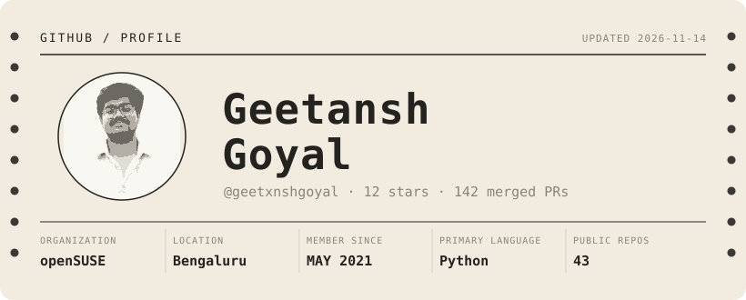
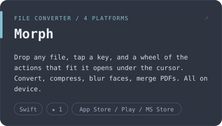
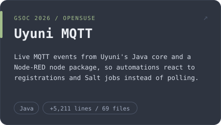
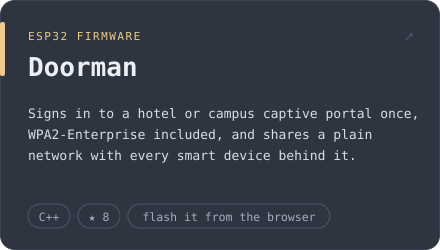
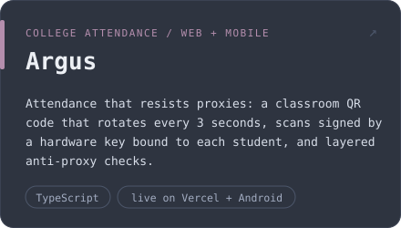
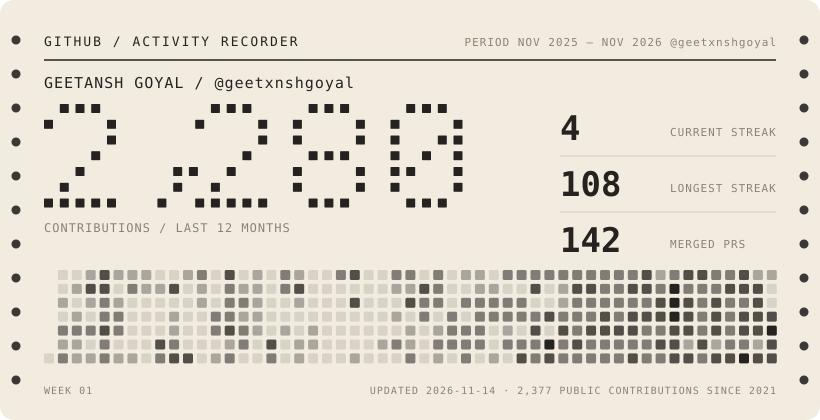

I write backend systems and developer tooling, mostly in the open, and I ship apps people install.
Google Summer of Code 2026 with **openSUSE**, ICPC Amritapuri regionalist, B.Tech CS at Newton
School of Technology in Bengaluru.

### What I've built

<table>
<tr>
<td width="50%" valign="top">
 
<a href="https://morph.geetanshgoyal.in">website</a> · <a href="https://apps.apple.com/in/app/morph-file-converter/id6827647585">App Store</a> · <a href="https://play.google.com/store/apps/details?id=app.morph">Google Play</a> · <a href="https://apps.microsoft.com/detail/9PHWJVRC85DW">Microsoft Store</a>
</td>
<td width="50%" valign="top">
 
<a href="https://github.com/uyuni-project/uyuni-rfc/pull/119">RFC #119</a> · <a href="https://github.com/uyuni-project/uyuni/pull/12385">PR #12385</a> · <a href="https://news.opensuse.org/2026/09/03/gsoc-2026-uyuni-mqtt-nodered/">openSUSE News write-up</a>
</td>
</tr>
<tr>
<td width="50%" valign="top">
 
<a href="https://geetxnshgoyal.github.io/m5-StickC-plus2-doorman/">flash it from your browser</a>
</td>
<td width="50%" valign="top">
 
<a href="https://argus-attendance.vercel.app">live app</a> · <a href="https://github.com/geetxnshgoyal/argus/releases/latest/download/argus.apk">Android APK</a>
</td>
</tr>
</table>

### The record

Both cards are drawn by <a href="scripts/cards.py">scripts/cards.py</a> from public GitHub data and refreshed nightly.

### Elsewhere

Spoke at **openSUSE Conference 2026** in Nuremberg, presented Bengaluru's bid to host
**openSUSE.Asia Summit 2027** in Yogyakarta, [openSUSE Member](https://en.opensuse.org/openSUSE:Members)
since February 2026, and ran **DevForge**, my college's developer club, for a year.

[geetanshgoyal.in](https://geetanshgoyal.in) &nbsp;·&nbsp;
[LinkedIn](https://www.linkedin.com/in/geetanshgoyal/) &nbsp;·&nbsp;
[goyalgeetansh@gmail.com](mailto:goyalgeetansh@gmail.com)
